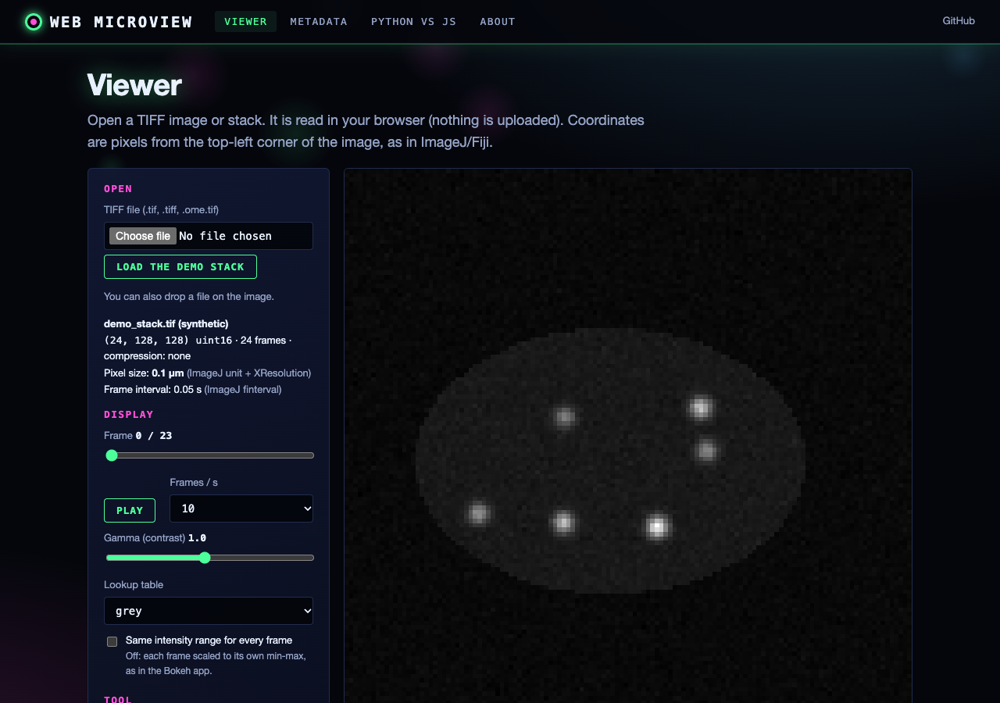
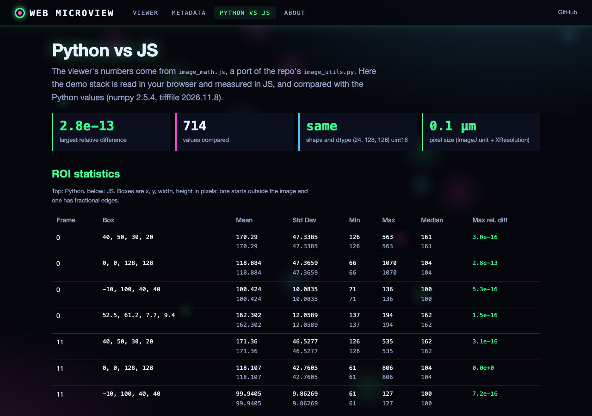
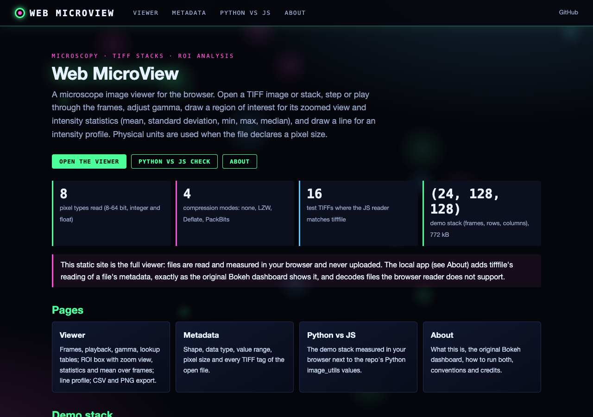
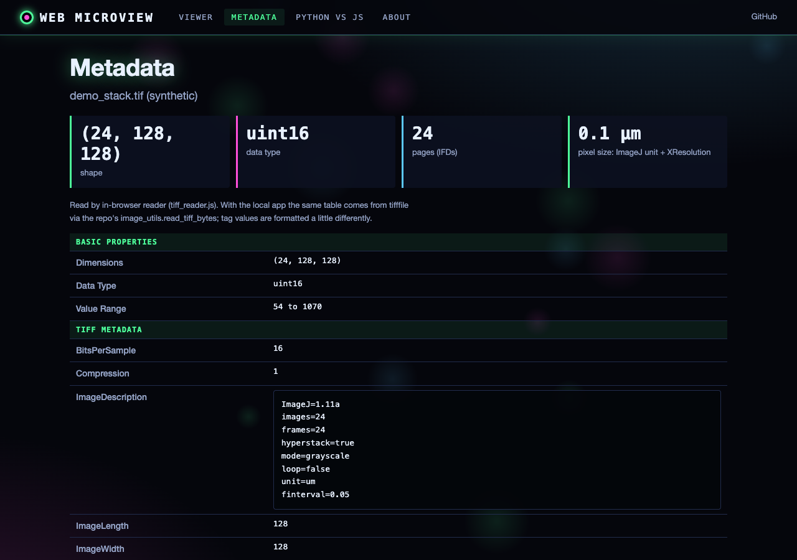

# Web MicroView

A web-based microscopy image viewer and analysis dashboard built with Bokeh. Provides interactive TIFF stack visualization with ROI tools, intensity analysis, and metadata display.

## Features

- **TIFF stack viewer** with frame-by-frame navigation
- **ROI (Region of Interest) tools** -- box selection for intensity measurement
- **Intensity analysis** with statistical summaries (mean, std, min, max, median) and a zoomed ROI view
- **RGB / multi-sample TIFFs** shown one channel at a time (channel selector)
- **Gamma (contrast) slider**; the line-profile toggle is a placeholder in the Bokeh app (not implemented yet)
- **Metadata viewer** for TIFF file properties
- **Interactive controls** -- sliders, buttons, file upload
- **Web-based** -- runs in any modern browser via Bokeh server

## Requirements

- Python 3.9+ (Bokeh 3.2+)
- bokeh, tifffile, numpy, scipy (versions in `requirements.txt`)

```bash
pip install -r requirements.txt
```

## Usage

```bash
bokeh serve app.py
```

Then open `http://localhost:5006/app` in your browser. Upload a TIFF stack using the file input widget.

## Web interface

Besides the Bokeh dashboard there is a browser viewer with the same features plus a working line profile,
playback, lookup tables, ROI mean over frames, physical units (when the file declares a pixel size) and
CSV/PNG export. It reads TIFFs in the browser with a pure-JS reader tested against tifffile, and measures with
`image_math.js`, a port of `image_utils.py` tested against it.

- **Live static site:** https://gddickinson.github.io/web_microview/ (the full viewer; files never leave the browser)
- **Run the web app** (adds tifffile metadata exactly as the Bokeh app shows it, and decodes TIFFs the browser
  reader does not support, e.g. LZMA or JPEG with imagecodecs):

```bash
pip install -r requirements-web.txt
python run_web.py            # http://127.0.0.1:8136
```

| Viewer | Python vs JS |
|---|---|
|  |  |
|  |  |

The demo stack (`web/static/demo/demo_stack.tif`) is synthetic, made by `scripts/make_demo.py`.
Tests: `python -m pytest -q tests` (web, fixtures, image utils; the Bokeh dashboard tests run when bokeh is
installed) and `node web/static/tiff_reader.test.mjs`, `node web/static/image_math.test.mjs`.
Static build: `python scripts/build_static.py` (published to GitHub Pages by `.github/workflows/pages.yml`).

## Project Structure

```
web_microview/
├── app.py          # MicroscopyDashboard class and Bokeh server app
├── image_utils.py  # TIFF loading, normalisation/gamma, ROI clipping and statistics
├── roi_tools.py    # ROI BoxAnnotation
├── tiff_meta.py    # physical pixel size from OME / ImageJ metadata
├── run_web.py      # starts the web app on 127.0.0.1:8136
├── web/            # FastAPI app + browser viewer (see INTERFACE.md)
├── scripts/        # demo stack, Python-vs-JS fixtures, static build, screenshots
└── tests/          # pytest tests (python -m pytest -q tests)
```

Coordinates: pixels from the top-left corner of the image (row 0 at the top), as in ImageJ/Fiji.


---
*Built with AI assistance from [Claude (Anthropic)](https://claude.com/).*
